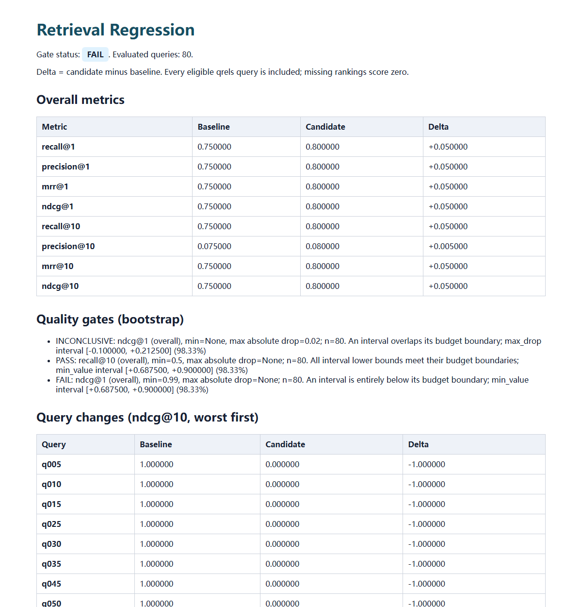

# Retrieval Regression

[](https://github.com/DengyiGu/retrieval-regression/actions/workflows/ci.yml)
[](pyproject.toml)

**Catch retrieval quality regressions before they reach your RAG application.**

A local-first Python library for comparing search results, finding query-level regressions,
and enforcing quality thresholds in automated tests. No paid APIs, LLM judges, GPU, or runtime
dependencies are required for the core library.

**Status:** working alpha (`0.4.0` source; latest model release `v0.3.0`). Install from this repository; no PyPI release is claimed.

## The problem

You change an embedding model, chunking strategy, index, or reranker. The overall score improves,
but an important query category gets worse. Or a run silently omits difficult queries and the
reported average becomes misleading.

Retrieval Regression evaluates both runs over the **same complete set of judged queries**,
shows what changed, and lets you fail a test when a configured quality budget is exceeded.
It evaluates retrieved document rankings, not generated-answer correctness.

## When to use it

Use this library when you already have relevance judgments and exported baseline/candidate
rankings, and want a repeatable pass/fail check in CI. For example, accept an index change only
if overall NDCG@10 drops by no more than 0.02 and an important query category keeps Recall@10
above its minimum. Keep corpus IDs and judgment semantics stable across the two runs.

[ranx](https://amenra.github.io/ranx/compare/) is the closest established alternative: it
compares multiple systems and supplies statistical tests, alongside a broader evaluation and
fusion toolkit. Use it for multi-system research comparisons. This project's narrower focus
is a regression budget workflow: per-category absolute budgets, explicit
**pass / fail / inconclusive** decisions, pytest/CLI enforcement, input fingerprints and an
offline report, with no runtime dependencies. This is a workflow choice, not a claim of better
statistics or speed. [ir-measures](https://ir-measur.es/en/latest/) covers many more metrics;
[BEIR](https://github.com/beir-cellar/beir) provides datasets and retrieval benchmarks.

Changing chunk boundaries or document IDs requires corresponding judgment mapping; this library
does not create that mapping. It also needs external judgments and cannot assess generated answers.

## Install from source

Python 3.10+ is required. These commands work in Windows PowerShell and POSIX shells:

```console
git clone https://github.com/DengyiGu/retrieval-regression.git
cd retrieval-regression
python -m venv .venv
```

On Windows, use the environment directly without changing PowerShell execution policy:

```powershell
.\.venv\Scripts\python.exe -m pip install -e ".[dev,reference]"
.\.venv\Scripts\python.exe -m pytest -q
.\.venv\Scripts\python.exe examples/quickstart.py
```

On Linux/macOS:

```bash
.venv/bin/python -m pip install -e '.[dev,reference]'
.venv/bin/python -m pytest -q
.venv/bin/python examples/quickstart.py
```

For runtime-only use, install with `python -m pip install .`. To use the pytest fixture,
install `python -m pip install '.[pytest]'`. Installation downloads dependencies unless they
are cached; evaluation and the bundled examples run offline after installation.

## Python API

```python
from retrieval_regression import Threshold, compare
from retrieval_regression.reporting import write_html

qrels = {"install": {"doc-a": 2}, "api": {"doc-b": 1}}
baseline = {"install": {"doc-a": 0.9}, "api": {"wrong": 0.9, "doc-b": 0.8}}
candidate = {"install": {"doc-a": 0.9}, "api": {"doc-b": 0.9}}

result = compare(
    qrels,
    baseline,
    candidate,
    k=[1, 5],
    groups={"install": "setup", "api": "reference"},
    thresholds=[Threshold("recall@5", min_value=0.9, max_drop=0.02)],
    bootstrap_samples=1000,
    seed=42,
)

print(result.delta)  # candidate minus baseline
print(result.passed)  # True
print(result.per_query_delta["api"])
write_html(result, "reports/comparison.html")
```

Use `evaluate(qrels, run, k=[1, 5])` for a single run. See [API and data formats](docs/API.md).

## Command line

After activating the environment, `rr` and `retrieval-regression` are aliases for the same CLI.
You can also invoke it with the environment's Python:

```console
python -m retrieval_regression compare --qrels examples/toy/qrels.json --baseline examples/toy/baseline.json --candidate examples/toy/candidate.json --groups examples/toy/groups.json --config examples/toy/gates.json --k 1 3 --json reports/comparison.json --html reports/comparison.html
```

Use the virtual environment's Python path if it is not activated. The command writes reports
and prints full JSON by default. Add `--summary` for bounded CI output or `--stdout none`
to write files only. `--json` always retains full query-level evidence. Replace `candidate.json` with `regressed.json` to demonstrate a
failed gate. Exit codes: **0** success, **1** failed quality gate, **2** invalid input/configuration, **3** inconclusive statistical gates (blocked by default).
No configured thresholds means comparison only, not quality enforcement.

## Uncertainty-aware regression gates

Point gates remain the backward-compatible default. To avoid treating a noisy sample mean
as conclusive evidence, request percentile bootstrap gates on independent held-out queries:

```python
result = compare(
    qrels,
    baseline,
    candidate,
    k=[10],
    thresholds=[Threshold("ndcg@10", max_drop=0.02)],
    gate_mode="bootstrap",
    bootstrap_samples=5000,
    confidence=0.95,
    min_queries=20,
    seed=42,
)
print(result.status)  # pass, fail, inconclusive, or not_gated
```

For `max_drop=0.02`, a delta interval entirely above -0.02 passes; entirely below it fails;
an overlapping interval is inconclusive. Categories are resampled separately. Gate bounds
use a Bonferroni adjustment by default; descriptive metric/group intervals remain unadjusted.
CLI: add `--gate-mode bootstrap --bootstrap-samples 5000 --summary`. Inconclusive blocks
with exit 3; `--on-inconclusive warn` explicitly permits continuation with a warning and keeps
the result inconclusive. The pytest fixture accepts the same policy.

A seeded 300-trial, 30-query synthetic A/A check produced **137 point failures versus
7 bootstrap failures, 278 inconclusive results and 15 passes**. Fewer definite failures do
not imply more safe approvals: small samples often cannot establish non-inferiority.
Coverage is approximate, particularly for sparse/degenerate samples; the minimum query count
is a guardrail, not a statistical guarantee. See [evidence and limitations](docs/EVIDENCE.md).



The screenshot uses synthetic demonstration data; it is not a measured model improvement.

## Standard retrieval files and reproducible runs

Load an existing BEIR test split and TREC exports directly:

```python
from retrieval_regression import load_qrels, load_run, compare

qrels = load_qrels("examples/formats/qrels.tsv", format="beir")
baseline = load_run("examples/formats/baseline.run", format="trec")
candidate = load_run("examples/formats/candidate.run", format="trec")
result = compare(qrels, baseline, candidate, k=[1, 3])
```

The CLI accepts separate formats for each input, so migration can mix JSON and TREC runs:

```console
python -m retrieval_regression compare --qrels examples/formats/qrels.tsv --qrels-format beir --baseline examples/formats/baseline.run --baseline-format trec --candidate examples/formats/candidate.run --candidate-format trec --config examples/toy/gates.json --groups examples/toy/groups.json --k 1 3 --json reports/comparison.json --html reports/comparison.html --manifest reports/manifest.json
```

Parsers reject duplicate judgments/documents/ranks, mixed run tags, invalid headers and
non-finite scores with file/line diagnostics. Ranks are checked against scores; scoring still
uses descending scores and ascending document IDs for ties by default. This differs from
`trec_eval` and the `ir-measures` pytrec_eval provider on tied scores; select
`tie_breaker="doc_id_desc"` / `--tie-breaker doc_id_desc` for that ordering. The adapters intentionally support
[a documented strict profile](docs/API.md#file-format-profiles), rather than every historical
TREC variant. Missing rankings remain in the evaluation denominator.

Negative grades and topics without positives are rejected by default. For collections that
contain them, load with `load_qrels(..., strict=False)`, then choose explicit evaluation policies:
`negative_grades="clip"` (replace negatives with zero) or `"drop"` (remove those judgments),
and `no_positive="keep"` (zero metrics) or `"drop"` (exclude those topics). CLI uses
`--negative-grades clip --no-positive keep`. Reports retain policy diagnostics and both input
and evaluated query counts; dropping topics changes the denominator. These options do not
relax duplicate, malformed-row or non-finite-number checks.

An optional manifest records SHA-256/size/format for every input (including gates and groups),
evaluator/Python versions, parameters and a canonical result fingerprint. It contains base
filenames rather than machine-specific absolute paths. Input contents are rechecked before
reports are written. Keep the original input files with the manifest to reproduce a run.

## Neural reranking and local model experiments

`rerank(queries, corpus, run, scorer, top_k=50, batch_size=32)` connects candidate rankings to
any pair scorer that returns one numeric score per query/document text pair. It has no model
provider dependency. The optional [neural experiment](experiments/reranking/README.md) provides
an actual Transformer scorer, model fine-tuning and local search:

```console
python -m pip install -e '.[benchmark,neural]'
python -m experiments.reranking.run --download
python -m examples.neural_search --query "Does smoking increase cancer risk?" --dataset scifact
```

Install a suitable CUDA PyTorch build for GPU use. Downloads are opt-in; after caching, model
inference/training runs locally. The experiment compares a pinned pretrained MiniLM reranker
with random-negative and hard-negative fine-tuning, selects on a training-derived validation
split, and reports every variant on SciFact and NFCorpus held-out tests.

[The measured neural report](docs/reports/2026-11-12-neural.md) includes actual training,
model-quality and GPU-memory results. Two checked random-negative seeds and one hard-negative run support local observations;
they do not establish universal gains. Dataset and pretrained-weight terms remain separate
from the code license; raw texts are not redistributed; adapted weights are separately available in the Release below.

## Download the adapted model

The [v0.3.0 model release](https://github.com/DengyiGu/retrieval-regression/releases/tag/v0.3.0)
provides `scifact-minilm-reranker-v0.3.0.zip` and `SHA256SUMS`. Extract the archive to obtain
`scifact-minilm-reranker/`; weights and tokenizer are complete, so retraining is optional.
See the [model card](experiments/reranking/MODEL_CARD.md) for loading, attribution and limitations.
With the corpus cached, search using the downloaded checkpoint:

```console
python -m examples.neural_search --checkpoint scifact-minilm-reranker --query "your English query"
```

Code and experiments stay in this repository; model binaries are Release assets rather than
Git history. The released seed-13 checkpoint was selected on validation after one additional
seed check. Both checked runs improved SciFact NDCG@10; broader improvements are not established.

## pytest integration

The optional plugin registers the `retrieval_check` fixture:

```python
from retrieval_regression import Threshold


def test_retrieval_quality(retrieval_check):
    retrieval_check(
        {"q": {"relevant-doc": 1}},
        {"q": {"relevant-doc": 1.0}},
        {"q": {"relevant-doc": 1.0}},
        k=[5],
        thresholds=[Threshold("recall@5", max_drop=0.02)],
    )
```

The fixture requires an explicit threshold and fails with metric details when a gate fails.
Try `python -m pytest examples/test_retrieval_quality.py -q`.

## Available now

- Recall@K, Precision@K, MRR@K, and graded NDCG@K.
- Batched, model-independent reranking with caller-supplied scoring.
- Optional local neural inference, controlled fine-tuning ablation and a usable search example.
- Fixed-query macro averaging, including missing and empty rankings as zero.
- Strict JSON, original BEIR qrels TSV, TREC qrels and TREC run loading.
- File/line errors for duplicate rows, invalid ranks, mixed tags and score/rank conflicts.
- Optional input/result fingerprints for portable, auditable evaluation records.
- Deterministic tie handling and diagnostics for unjudged retrieved documents.
- Overall and user-defined category comparisons, with absolute quality-drop budgets.
- Seeded overall/category paired-bootstrap intervals and optional three-state statistical gates.
- Explicit negative-grade / zero-positive-topic policies and concise CLI summaries.
- Local HTML/JSON reports, Python API, CLI, and pytest integration.
- Hand-calculated tests and optional independent checks against `ir-measures`.

## Evaluation conventions

- Every eligible query in qrels is evaluated. Strict defaults require positives; explicit policies can keep or drop zero-positive topics.
- Retrieval scores sort descending; ties default to ascending document ID, optionally descending for trec_eval parity.
- Positive relevance grades count as relevant for binary metrics.
- NDCG uses **linear graded gain**, matching `trec_eval`'s `ndcg_cut` convention.
- Unjudged documents count as non-relevant; incomplete judgments limit interpretation.
- Precision divides by K even if fewer than K documents are returned.
- Unknown query IDs and invalid configuration raise errors instead of being silently ignored.
- `max_drop=0.02` means **two absolute percentage points**, not a 2% relative change.

Full definitions, limitations, and statistical assumptions: [evaluation protocol](docs/EVALUATION.md).

## Project map

```text
src/retrieval_regression/    Metrics, validation, comparisons, reports, CLI, pytest plugin
tests/                      Correctness, integration, and independent-reference checks
examples/                   Offline toy data and runnable usage
benchmarks/                 SciFact validation, evaluator scaling and gate calibration
experiments/reranking/      Optional local Transformer inference and fine-tuning
scripts/                    Reusable development, packaging and install checks
docs/                       Requirements, architecture, research protocol and roadmap
```

## Development and research

Start with [development setup](docs/DEVELOPMENT.md), [requirements](docs/REQUIREMENTS.md),
and the [roadmap](docs/ROADMAP.md). Run `python scripts/check.py` after changes.
The synthetic example demonstrates behavior. The [evidence guide](docs/EVIDENCE.md) collects
specific findings and limitations: noisy gate calibration, real qrels compatibility, and
held-out neural results. SciFact improvement is a measured local result; external NFCorpus
improvement is not established. No universal model improvement, evaluator speedup or external
adoption is claimed.

Run `python benchmarks/scifact.py --download` for the lexical experiment after installing
`.[benchmark]`; rerun offline once cached. Run `python benchmarks/gate_calibration.py` for the
small CPU-only gate simulation. The [neural experiment](experiments/reranking/README.md)
contains the optional model workflow. Large-run streaming remains future work.

## Maintainer

[Dengyi Gu](https://github.com/DengyiGu).

## License

[MIT](LICENSE).
